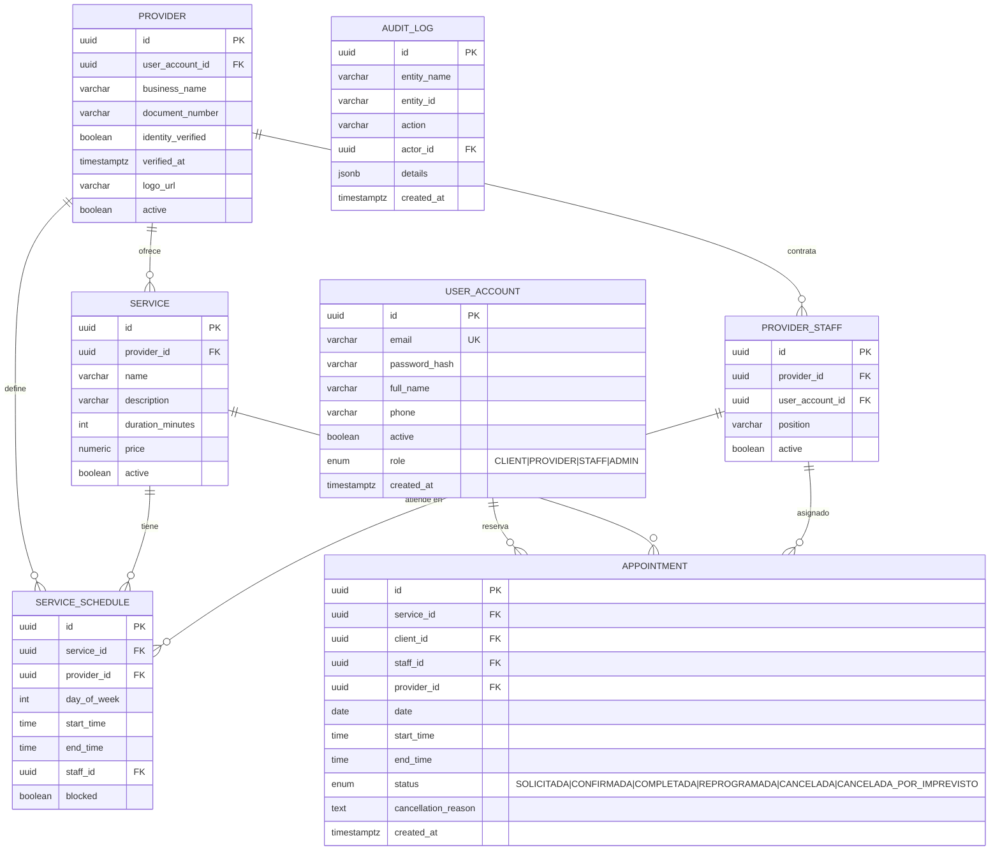
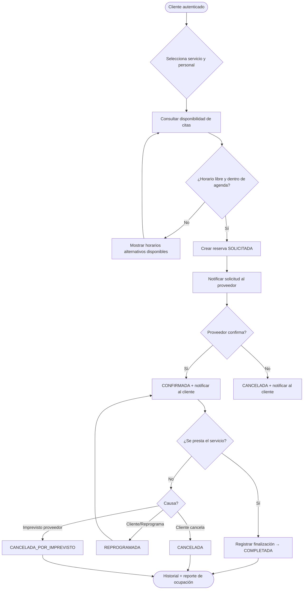
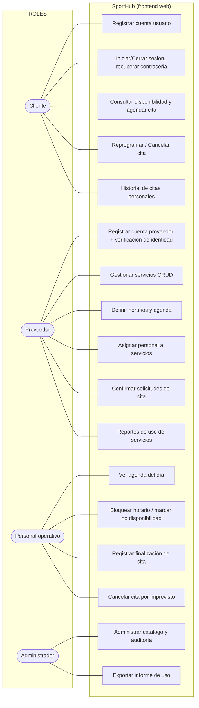
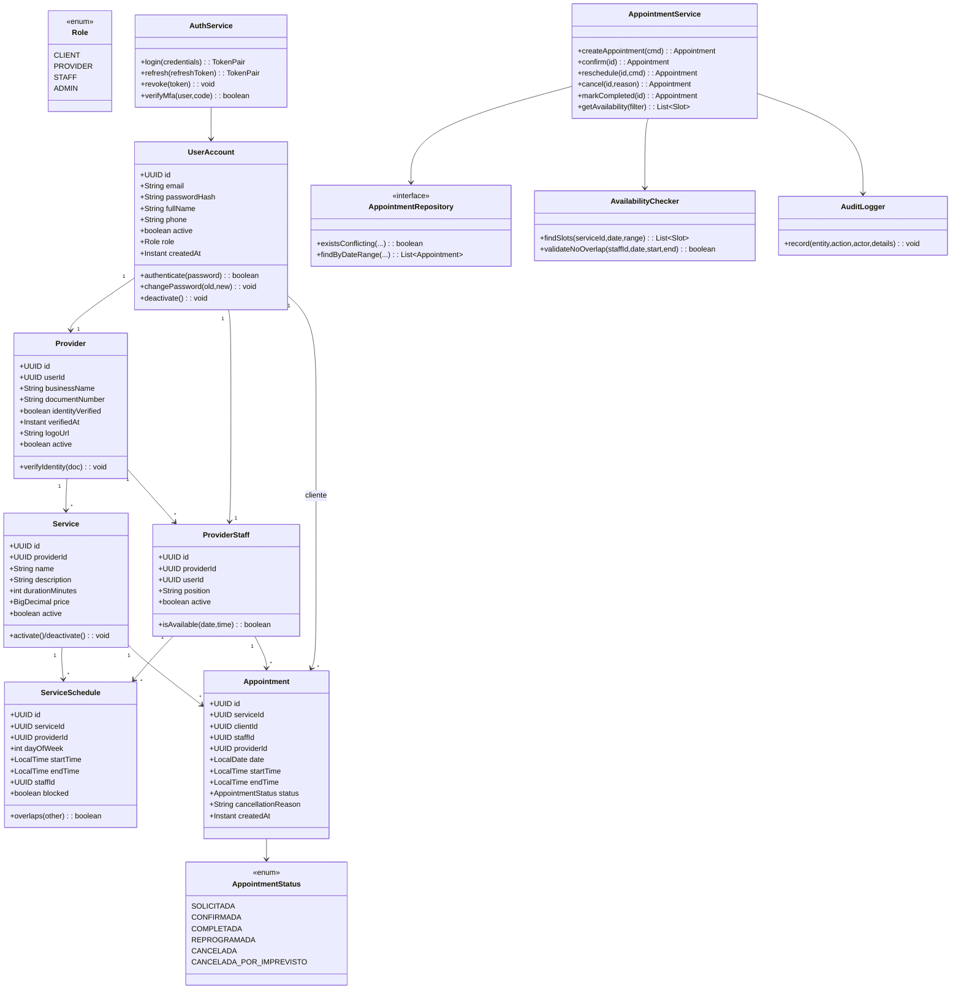
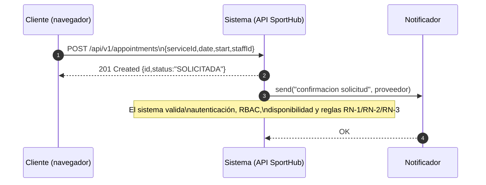
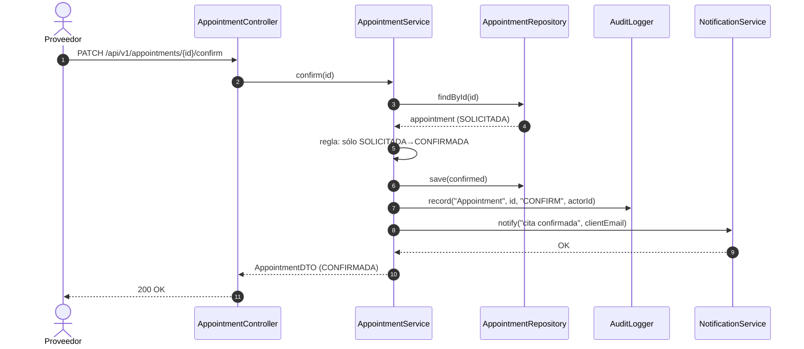

# Plataforma de Reservas de Servicios — SportHub

## Documento de Análisis y Diseño del Sistema

---

|                     |                                                              |
|---------------------|--------------------------------------------------------------|
| **Equipo de Trabajo** | Fabrica_escuela_2026_1                                      |
| **Responsables**      | 1037653210 – Nombre Estudiante 1<br>1037845122 – Nombre Estudiante 2<br>1017223456 – Nombre Estudiante 3<br>1040034567 – Nombre Estudiante 4 |
| **Proyecto**          | Caso 14 — Plataforma de Reservas de Servicios (Handbook de Casos 2026-2) |
| **Módulo**            | Gestión de Reservas y Agendas (plataforma completa, perfil Avanzado) |

### Historia de revisiones

| Fecha           | Versión | Descripción                                                       | Autor            |
|-----------------|---------|-------------------------------------------------------------------|------------------|
| 17/09/2026      | 0.1     | Borrador inicial: contexto, analisis del problema y backlog       | Equipo           |
| 20/09/2026      | 0.5     | Diseno tecnico, arquitectura, patrones y pruebas                  | Equipo           |
| 26/09/2026      | 1.0     | Entorno operativo, despliegue y validacion integral               | Equipo           |

---

# Modelo de Análisis y Diseño

## Resumen ejecutivo

Este documento describe el **análisis y diseño** de **SportHub**, la plataforma para la administración de **reservas de servicios** (clínicas, consultorios, salones de belleza y centros deportivos) propuesta en el **Caso 14** del Handbook de Casos 2026-2.

En él se encuentra: (1) el contexto, los objetivos y el alcance; (2) el análisis sistémico del problema con su modelo conceptual, el diagrama de procesos y los casos de uso; (3) el *User Story Mapping* con 57 historias de usuario (51 comprometidas en el backlog `Fabrica_escuela_2026_1` y 6 adicionales identificadas como necesarias), criterios de aceptación en Gherkin y lineamientos UI/UX; (4) el diseño técnico con arquitectura C4, diagrama de despliegue, de clases y de secuencias; (5) las responsabilidades mediante patrones **GRASP** y **GoF**, y el análisis de **antipatrones**; (6) la estrategia de **calidad, seguridad y gestión** (pruebas unitarias, funcionales y de aceptación, matriz de riesgos y deuda técnica); (7) la organización, cronograma y **presupuesto**; y (8) el **licenciamiento**. Adicionalmente se documenta el **entorno operativo completo** (Azure DevOps, contenedores, observabilidad con Prometheus/Grafana, pipeline CI/CD) preparado para el **despliegue** en nube (Render).

El propósito del proyecto es eliminar la sobreocupación, las cancelaciones desordenadas y la dificultad para gestionar agendas mediante una aplicación web en la que **proveedores** definen servicios, horarios y personal; **personal operativo** administra su agenda; y **clientes** consultan disponibilidad, reservan, reprograman y cancelan citas con trazabilidad y reportes de ocupación.

**Interesados**: clientes (usuarios finales que reservan), proveedores (dueños de negocios de servicios), personal operativo (quienes prestan el servicio) y administradores de plataforma. Su principal obstáculo actual es la gestión manual o fragmentada de las agendas, que genera choque de horarios y pérdida de citas.

**Conceptos clave**: reserva/cita, agenda, horario, servicio, proveedor, clientes, disponibilidad y personal operativo.

---

## 1. Contexto y Objetivos

### 1.1 Propósito del proyecto

Negocios como clínicas, consultorios, salones de belleza o centros deportivos dependen de sistemas de reservas para gestionar citas y disponibilidad de recursos. La falta de herramientas adecuadas genera sobreocupación, cancelaciones desordenadas y dificultades para gestionar agendas.

**SportHub** resuelve este problema mediante una plataforma web que permite:

- registrar usuarios y proveedores de servicios,
- definir agendas y horarios disponibles,
- crear, confirmar, reprogramar y cancelar reservas,
- controlar la disponibilidad de recursos y personal,
- registrar el historial de reservas, y
- generar reportes sobre ocupación y uso de los servicios.

### 1.2 Usuarios e interesados

| Interesado                    | Perfil                                                       | Necesidades                                                              | Obstáculos actuales                                              |
|-------------------------------|--------------------------------------------------------------|--------------------------------------------------------------------------|------------------------------------------------------------------|
| **Cliente / Usuario**         | Persona que consume servicios (paciente, cliente de salón, deportista) | Reservar citas en línea, ver disponibilidad real, reprogramar y cancelar sin llamadas | Sin visibilidad de horarios disponibles; largas filas telefónicas |
| **Proveedor**                 | Dueño o administrador del negocio                            | Publicar servicios y horarios, asignar personal, controlar ocupación     | Agendas manuales, sobreventa de horarios                          |
| **Personal operativo**        | Empleado que presta el servicio                              | Ver su agenda del día, registrar tiempos, bloquear imprevistos           | No sabe su carga laboral ni sus citas                             |
| **Administrador de plataforma** | Equipo CodeF@ctory / operador                               | Administrar catálogo, ver reportes, auditar acciones sensibles           | Sin métricas centralizadas de uso                                  |

### 1.3 Objetivos del sistema y alcance del módulo

- **O1.** Permitir el registro y la gestión segura de cuentas de usuarios y proveedores (HU-01→HU-11).
- **O2.** Autenticar y autorizar con RBAC y MFA para accesos administrativos (HU-12→HU-16, HU-19, HU-51).
- **O3.** Permitir a los proveedores registrar servicios, definir y modificar agendas y asignar personal (HU-17→HU-28).
- **O4.** Gestionar disponibilidad del personal operativo y validar superposiciones de horarios (HU-29→HU-32).
- **O5.** Permitir a los clientes consultar disponibilidad, agendar, reprogramar y cancelar citas (HU-33→HU-41).
- **O6.** Consultar historiales y filtros de citas (HU-42→HU-47).
- **O7.** Generar y exportar reportes de uso de servicios (HU-48→HU-50).
- **O8.** Incorporar notificaciones, auditoría y MFA como historias complementarias (HU-52→HU-57).
- **O9.** Cumplir los criterios del perfil avanzado: arquitectura por capas, API REST versionada, seguridad OWASP, calidad >65 % de cobertura, pipelines CI/CD y despliegue contenerizado en nube.

**Fuera de alcance**: pagos en línea, mensajería interna, aplicaciones móviles nativas y geolocalización de sedes.

### 1.4 Visión del producto

Una sola plataforma web y responsiva (Next.js + Tailwind + shadcn/ui) con un backend REST (Spring Boot 3.x) y base de datos PostgreSQL. El cliente abre SportHub, escoge el servicio y el profesional, ve la disponibilidad real en tiempo casi real y reserva en menos de un minuto. El proveedor configura su negocio (servicios, horarios, personal, fotos) desde un panel. El sistema previene choques de horarios, notifica confirmaciones y recordatorios, y entrega reportes de ocupación. Todo administrado en Azure DevOps con despliegue contenerizado (Docker Compose en Render) y observabilidad (Prometheus/Grafana).

---

## 2. Análisis del problema

### 2.1 Análisis sistémico de la situación problemática

**Identificación de categorías activas** (café de actores, procesos y causas):

| Categoría                  | Elementos activos                                                                 |
|----------------------------|-----------------------------------------------------------------------------------|
| **Actores del sistema**    | Cliente, Proveedor, Personal operativo, Administrador de la plataforma            |
| **Procesos problemáticos** | Reserva de citas, definición de agenda, asignación de personal, cancelaciones     |
| **Causas raíz**            | Agendas manuales (papel/Excel), ausencia de validación de disponibilidad, doble reserva, comunicación asíncrona con el cliente |
| **Efectos**                | Sobreocupación, cancelaciones desordenadas, pérdida de citas, insatisfacción del cliente, subutilización de recursos |

**Solución propuesta** a partir del análisis:

1. **Centralizar la agenda** como fuente de verdad: servicio → horario → personal → reserva.
2. **Automatizar la validación** de disponibilidad y superposición (regla de negocio de no choque de horarios).
3. **Digitalizar la interacción** con el cliente (confirmación, recordatorios, reprogación y cancelación autogestionada).
4. **Trazabilidad y reportes**: histórico de reservas y ocupación para optimizar recursos.

El sistema se modela alrededor del **ciclo de vida de una reserva**, con al menos estos estados: `SOLICITADA → CONFIRMADA → COMPLETADA`, más las transiciones `REPROGRAMADA`, `CANCELADA` (por cliente) y `CANCELADA_POR_IMPREVISTO` (por proveedor).

### 2.2 Modelo conceptual (dominio estático) — MER



**Reglas de negocio principales** (RN):

- **RN-1.** No puede existir más de una reserva activa (`SOLICITADA` o `CONFIRMADA`) para el mismo `service_id + staff_id + date + [start,end)` → evita sobreocupación.
- **RN-2.** No pueden superponerse horarios de un mismo personal en la misma fecha (agenda y ausencias).
- **RN-3.** La reserva solo se agenda dentro de un `SERVICE_SCHEDULE` activo y de un personal disponible.
- **RN-4.** Un cliente solo puede agendar sobre citas propias; la autorización por propiedad se resuelve en servidor (ABAC simple).
- **RN-5.** La cancelación con estado `CANCELADA_POR_IMPREVISTO` es exclusiva del proveedor/personal y dispara notificación al cliente.
- **RN-6.** Las acciones sensibles (eliminar cuenta, verificación de identidad, bloqueo de horario) se registran en `AUDIT_LOG`.

### 2.3 Diagrama de Procesos (dominio dinámico)

Flujo principal: **consultar disponibilidad → agendar → confirmar → completar/cancelar**.



Decisiones relevantes: validación de disponibilidad (RN-1/RN-2), confirmación del proveedor y transiciones de estado.

### 2.4 Diagramas de Casos de Uso



Los actores se autentican y el sistema aplica RBAC: `CLIENT`, `PROVIDER`, `STAFF`, `ADMIN` (MFA obligatorio para `ADMIN`).

---

## 3. Requerimientos y Experiencia de Usuario

### 3.1 User Story Mapping

El USM completo se mantiene en el repositorio y en Azure DevOps (`Fabrica_escuela_2026_1 \ Epic 1…7`) con enlace en anexos. Las **épicas (E)**, **features (F)** e **historias de usuario (HU)** priorizadas (MoSCoW) son:

| Épica | Feature | HU | Título | Prioridad |
|-------|---------|----|--------|-----------|
| E1 Cuentas de usuario | Autenticación y perfil | HU-01 | Registrar cuenta de usuario | Must |
| E1 | | HU-02 | Actualizar datos del usuario | Must |
| E1 | | HU-03 | Consultar perfil de la cuenta | Must |
| E1 | | HU-04 | Desactivar temporalmente la cuenta | Should |
| E1 | | HU-05 | Eliminar cuenta de usuario | Should |
| E1 | | HU-12 | Iniciar sesión | Must |
| E1 | | HU-13 | Cerrar sesión de forma segura | Must |
| E1 | | HU-14 | Cambiar contraseña | Must |
| E1 | | HU-15 | Recuperar contraseña | Must |
| E1 | | HU-16 | Recordar sesión en el dispositivo | Could |
| E1 | | HU-51 | Autorización de usuario (RBAC + tokens) | Must |
| E2 Cuentas de proveedor | Registro y KYC | HU-06 | Registrar cuenta de proveedor | Must |
| E2 | | HU-07 | Actualizar datos del proveedor | Must |
| E2 | | HU-08 | Verificar identidad del proveedor | Must |
| E2 | | HU-09 | Verificación de identidad periódica | Must |
| E2 | | HU-10 | Eliminar proveedor | Should |
| E2 | | HU-11 | Cargar logotipo y fotos del proveedor | Should |
| E2 | | HU-19 | Autorización de proveedor (RBAC + MFA) | Must |
| E3 Servicios y agenda | Catálogo | HU-17 | Registrar servicio | Must |
| E3 | | HU-18 | Activar servicio | Must |
| E3 | | HU-20 | Consultar servicio | Must |
| E3 | | HU-21 | Modificar servicio | Must |
| E3 | | HU-22 | Desactivar servicio | Must |
| E3 | | HU-23 | Definir horario del servicio | Must |
| E3 | | HU-24 | Modificar horarios del servicio | Must |
| E3 | | HU-25 | Consultar agenda del servicio | Must |
| E3 | | HU-26 | Bloquear horario en agenda | Should |
| E3 | | HU-27 | Modificar horario en fecha específica | Should |
| E3 | | HU-28 | Asignar personal a servicios específicos | Must |
| E4 Personal operativo | Gestión | HU-29 | Registrar personal operativo | Must |
| E4 | | HU-30 | Consultar disponibilidad del personal | Must |
| E4 | | HU-31 | Validar superposición de horarios del personal | Must |
| E4 | | HU-32 | Notificar no disponibilidad del personal | Should |
| E5 Reservas | Ciclo de vida | HU-33 | Consultar disponibilidad de citas | Must |
| E5 | | HU-34 | Agendar cita | Must |
| E5 | | HU-35 | Consultar citas programadas | Must |
| E5 | | HU-36 | Reprogramar cita | Must |
| E5 | | HU-37 | Cancelar cita | Must |
| E5 | | HU-38 | Consultar listado de citas | Must |
| E5 | | HU-39 | Registrar finalización de cita | Must |
| E5 | | HU-40 | Confirmar solicitud de cita | Must |
| E5 | | HU-41 | Cancelar cita por imprevisto | Must |
| E6 Historial y filtros | Consulta | HU-42 | Historial de citas personales | Must |
| E6 | | HU-43 | Historial de citas global | Must |
| E6 | | HU-44 | Filtrar citas personales por estado | Should |
| E6 | | HU-45 | Filtrar historial por personal | Should |
| E6 | | HU-46 | Filtrar historial por cliente | Should |
| E6 | | HU-47 | Filtrar historial por rango de fechas | Should |
| E7 Reportes | Analítica | HU-48 | Generar reporte de uso de servicios | Must |
| E7 | | HU-49 | Filtrar reporte por rango de fechas | Should |
| E7 | | HU-50 | Exportar informe de uso | Should |
| E8 Seguridad y transversal | Gobernanza | HU-52 | Notificar confirmación/recordatorio de cita | Should |
| E8 | | HU-53 | Notificar cancelación por imprevisto | Should |
| E8 | | HU-54 | Parámetros de atención y políticas de cancelación | Should |
| E8 | | HU-55 | Registrar auditoría de acciones sensibles | Must |
| E8 | | HU-56 | Activar MFA para acceso administrativo | Must |
| E8 | | HU-57 | Optimización de consultas e índices (rendimiento) | Could |

**Criterios de aceptación en Gherkin (historias clave):**

- **HU-01 — Registrar cuenta de usuario**
```gherkin
Característica: Registro de cuenta de usuario
  Como visitante
  Quiero crear una cuenta en la plataforma
  Para poder consultar y reservar servicios

  Escenario: Registro exitoso con datos válidos
    Dado que soy un visitante en la página de registro
    Cuando diligencio correo, nombre, teléfono y una contraseña que cumple la política
    Y acepto los términos y condiciones
    Entonces el sistema crea la cuenta con rol CLIENT
    Y envía un correo de confirmación de registro

  Escenario: Correo ya registrado
    Dado que existe una cuenta con el correo "pepito@mail.com"
    Cuando intento registrarme con "pepito@mail.com"
    Entonces el sistema rechaza el registro con el error UNICO_EMAIL
    Y no se crea ninguna cuenta
```

- **HU-12 — Iniciar sesión**
```gherkin
  Escenario: Inicio de sesión exitoso
    Dado que tengo una cuenta activa registrada
    Cuando ingreso mis credenciales correctas
    Entonces el sistema retorna un token JWT con expiración y el rol del usuario

  Escenario: Bloqueo por intentos fallidos
    Dado que intento autenticarme con credenciales incorrectas
    Cuando fallo 5 veces consecutivas
    Entonces el sistema bloquea la cuenta por 30 minutos
    Y registra el evento de seguridad en auditoría
```

- **HU-34 — Agendar cita**
```gherkin
  Escenario: Cita creada en horario disponible
    Dado que soy un cliente autenticado
    Y existe un servicio con agenda activa y personal disponible
    Cuando selecciono fecha y hora libre dentro del horario
    Entonces el sistema crea la reserva en estado SOLICITADA
    Y notifica al proveedor para su confirmación

  Escenario: Horario ya reservado
    Dado que el horario [fecha, hora] ya tiene una reserva activa
    Cuando intento agendar en ese horario
    Entonces el sistema rechaza la solicitud con el error HORARIO_OCUPADO
    Y sugiere horarios alternativos disponibles
```

- **HU-51 / HU-19 — Autorización**
```gherkin
  Escenario: Acceso denegado por rol
    Dado que soy un usuario con rol CLIENT autenticado
    Cuando intento acceder al endpoint de administración de proveedores
    Entonces el sistema responde 403 FORBIDDEN
    Y registra el evento en auditoría

  Escenario: MFA administrativo
    Dado que soy un usuario con rol ADMIN
    Cuando inicio sesión
    Entonces el sistema exige un segundo factor antes de permitir el acceso
```

*(El conjunto completo de 57 historias con sus criterios de aceptación está en `azure-devops/backlog/backlog-fabrica_escuela_2026_1.csv` y se sincroniza por script con Azure DevOps.)*

**Enlace al USM**: `https://dev.azure.com/<org>/Fabrica_escuela_2026_1` (ver README-AZURE-DEVOPS).

### 3.2 Mockups y Diseño Gráfico (UI/UX)

**Herramientas**: Figma Make (prototipo base "Sign-up Page Design" enlazado en el caso), Figma para componentes, Next.js + Tailwind CSS + shadcn/ui para la implementación.

**Sistema de diseño**:
- Tipografía: Inter (escala tipográfica 12/14/16/20/24).
- Paleta: primario `#6D28D9` (violeta), neutros `#111827/#F9FAFB`, estado `#16A34A/#DC2626`, con contraste AA verificado.
- Espaciado base 4px; radio 8px; sombras suaves; iconografía Lucide.

**Flujo principal del prototipo**:
1. **Registro/Ingreso** (`/registro`, `/login`): selección de rol (Cliente/Proveedor), validación en cliente y mensajes de error accesibles.
2. **Exploración de servicios**: buscador, tarjetas de servicio con foto, precio, duración y estado (disponible/ocupado).
3. **Selección fecha/hora**: selector de calendario con franjas disponibles resaltadas; bloqueos visibles.
4. **Confirmación de cita**: resumen, botón agendar y estado de éxito con folio de la reserva.
5. **Panel proveedor**: agenda semanal, gestión de servicios, personal y reportes.

**Decisiones de diseño relevantes**:
- Estados explícitos (carga/esqueleto, vacío, error, éxito, deshabilitado y permisos insuficientes) en cada pantalla (lineamiento UI/UX 8.4).
- Validación en cliente para UX + validación en servidor como fuente de verdad.
- Accesibilidad WCAG 2.2 AA: teclado, foco visible `focus-visible`, `prefers-reduced-motion`, HTML semántico y formularios con `label` asociado.

**Enlace al prototipo interactivo**: enlace Figma (ver Anexos). Mockups adicionales en `docs/mockups/`.

---

## 4. Diseño Técnico y Arquitectura

### 4.1 Arquitectura del Sistema

**Estilo**: monolito modular con arquitectura por capas (presentación/aplicación/dominio/infraestructura), API REST versionada y separación explícita de dominios. Justificación: el alcance (reservas) tiene alta cohesión y bajo volumen; un monolito modular reduce la complejidad operativa del equipo académico, mantiene la regla de negocio central (disponibilidad) en un solo lugar transaccional y permite evolucionar a microservicios si el volumen lo exige.

**C4 — Diagrama de contenedores y despliegue**:

```mermaid
flowchart LR
    B[["Navegador
        (Cliente web)"]]
    subgraph CLD["Nube (Render)"]
        FE["Contenedor Frontend
            Next.js 15 / Node 20
            :3000"]
        BE["Contenedor Backend
            Spring Boot 3 / Java 17
            :8080"]
        DB[("Servicio PostgreSQL 16
        (Supabase/Neon en prod)")]
        PM["Prometheus :9090"]
        GF["Grafana :3001"]
    end
    subgraph AZ["Azure DevOps / GitHub"]
        PIP["Azure Pipelines CI/CD"]
        GH["GitHub Repos (feature/…)"]
        SON["SonarCloud"]
    end
    B -->|HTTPS| FE
    FE -->|"/api/v1 REST + JWT"| BE
    BE -->|JDBC (parametrizado)| DB
    BE -->|"/actuator/prometheus"| PM
    PM --> GF
    PIP -->|build, test, push image| BE
    PIP -->|Quality Gate| SON
    GH --> PIP
```

**Justificación de decisiones**:
- **Frontend Next.js + Tailwind + shadcn/ui** por lineamiento UI/UX 8.1 y SSR/SEO del catálogo de servicios.
- **Backend Spring Boot 3.x + Java 17** por perfil tecnológico armonizado avanzado.
- **PostgreSQL 16** como base transaccional; en producción `Supabase`/`Neon` administrado (lineamientos 7.3).
- **JWT (OAuth2/OIDC compatible)** con cookies `HttpOnly`+`Secure`+`SameSite=Lax`, expiración, rotación y revocación.
- **Docker Compose** para reproducibilidad y despliegue multi-contenedor en Render (lineamiento 7.3); Kubernetes como evolución opcional.
- **Prometheus + Grafana** para observabilidad, con logs estructurados JSON y `traceId` (lineamiento 7.3).
- **API versionada** bajo `/api/v1/` con OpenAPI/Swagger publicado (lineamiento 3.3).

**Requisitos no funcionales**:

| Atributo | Objetivo |
|----------|----------|
| Rendimiento | ≥200 req/min y respuesta ≤200 ms por operación (p95) |
| Disponibilidad | 99,9 % en producción con health checks y reversión |
| Escalabilidad | Componentes sin estado; horizontal del backend |
| Seguridad | OWASP Top Ten, RBAC+ABAC, MFA admin, SCA/SAST, cero vulnerabilidades críticas |
| Usabilidad/Accesibilidad | WCAG 2.2 AA |
| Mantenibilidad | Módulos por dominio, pruebas automatizadas, documentación viva |
| Trazabilidad | `traceId` en logs, correlación HU→código→prueba→despliegue (entrega Azure DevOps) |

### 4.2 Diseño Estático — Diagrama de Clases



**Aplicación de SOLID**:
- **SRP**: cada clase tiene una responsabilidad (ej. `AvailabilityChecker` solo valida disponibilidad; `AuditLogger` solo persiste auditoría).
- **OCP**: los estados de cita se extienden sin modificar la lógica base (composición de transiciones); nuevas reglas de disponibilidad se añaden sin tocar `AppointmentService`.
- **LSP**: `AppointmentRepository` como interfaz permite reemplazar JPA por otra implementación sin afectar el servicio.
- **ISP**: interfaces pequeñas (repositorios por agregado) en vez de repositorios "todoterreno".
- **DIP**: `AppointmentService` depende de `AppointmentRepository`/`AvailabilityChecker` (abstracciones), no de implementaciones concretas.

### 4.3 Diseño Dinámico — Diagramas de Secuencias

**4.3.1 Secuencia de caja negra — "Agendar cita" (actor → sistema)**:



**4.3.2 Secuencia con objetos — "Confirmar solicitud de cita"** (lógica interna):



---

## 5. Responsabilidades e Interacciones

### 5.1 Patrones GRASP

Aplicados (mínimo 3):

- **Experto en información**: `ServiceSchedule`/`ProviderStaff` son expertos en sus datos y exponen `overlaps()`/`isAvailable()`; `AvailabilityChecker` coordina agendas sin duplicar datos (cumple alta cohesión).
- **Creador**: `AppointmentService.createAppointment()` crea `Appointment` porque es quien define el contexto de entrada (encaja el criterio "B contiene/agrega/registra A").
- **Controlador**: `AppointmentController` y `AuthenticationController` son la fachada de entrada que desacopla HTTP de la lógica de dominio.
- **Alta cohesión / Bajo acoplamiento**: los servicios de dominio (`AppointmentService`) no conocen detalles de HTTP ni de persistencia (DIP) reduciendo acoplamiento con Spring MVC/JPA.
- **Polimorfismo**: `NotificationService` con implementaciones `EmailNotification`/`PushNotification` intercambiables.
- **Pur fabricación**: `AvailabilityChecker` se introduce como clase pura de lógica de negocios sin entidad del dominio, evitando inflar `ServiceSchedule`.
- **Indirección**: repositorios e interfaces median entre aplicación y persistencia.

**Cómo se aplicarían los restantes**: *Varíe el acoplamiento* mediante configuración por interfaces de servicios externos; *No se lo cuente* exponiendo DTOs restringidos en la API; *Protección de variaciones* con Value Objects (p. ej. `Email`, `PasswordPolicy`) para encapsular reglas.

### 5.2 Patrones GoF

| Tipo | Patrón | Antes | Después |
|------|--------|-------|---------|
| **Creacional** | *Factory Method* | `AppointmentController` con `new Appointment(...)` disperso y con estados a mano | `AppointmentFactory.crear(status, datos)` centraliza la construcción y valida las transiciones permitidas |
| **Creacional** | *Singleton* | Beans Spring sin control | `App.Scheduler` (memoria caché) como bean `@Component` único |
| **Estructural** | *Adapter* | El backend depende directamente del proveedor de notificaciones (SMTP) | `NotificationService.send()` adapta `EmailClient`/`SmsClient` bajo una interfaz común |
| **Estructural** | *Facade* | El cliente llama a 5 servicios para agendar | `AppointmentFacade` (REST) expone una única operación de alto nivel |
| **Comportamiento** | *Strategy* | `if/else` por estado de cita y tipo de notificación | `TransitionStrategy` e `IRNPolicies` intercambiables según estado/contexto |
| **Comportamiento** | *Observer/Listener* | El negocio conoce a todos los notificadores | `ApplicationEventPublisher` → listeners (`AuditLogger`, `Notifier`) |

**Otros cinco GoF pertinentes y su justificación**:
1. **Builder** — construcción de consultas de reporte y DTOs de disponibilidad (fechas, filtros). Disminuye constructores telescópicos.
2. **Template Method** — esqueleto común de validación antes de persistir (contratos de API) reutilizable entre controladores.
3. **Command** — operaciones de caja/agendamiento reversibles (cancelar/reprogramar) que permiten historial (Command Log = auditoría).
4. **Memento** — snapshot del estado de una cita para auditar cambios (trazabilidad RN-6).
5. **Repository** (GoF Data Access) — abstracción de persistencia (ya usada) para sustituir PostgreSQL sin afectar dominio.

### 5.3 Antipatrones

**Antipatrones detectados y corregidos (evidencia antes/después) — 3**:

1. **God Class**: `AppointmentController` original agrupaba validación, pagos y reglas. → **Después**: separación en `AppointmentService`, `AvailabilityChecker`, `NotificationService`. *Justificación*: mejor SRP, testabilidad y reducción de complejidad ciclomática (<50 exigida).
2. **Copy-and-Paste Programming**: lógica de rango horario duplicada entre `ServiceSchedule` y `Appointment`. → **Después**: extracción de `TimeRange` (Value Object) con `overlaps()`. *Justificación*: una sola fuente de verdad de la regla RN-2.
3. **Magic Numbers**: límites como "5 intentos de login" y "30 min de bloqueo" en código. → **Después**: se exportan a `APP_parámetros` (tabla `settings`, HU-54). *Justificación*: parámetros configurables sin recompilar.

**Estrategias para evitar ≥5 antipatrones en el futuro**:
1. **Mutable Global State / Service Locator**: prohibir estáticos mutables; usar inyección de dependencias.
2. **Lava Flow**: limpieza incremental de código muerto en cada sprint y revisión de PR.
3. **Dead Code**: regla Sonar "unused code" con alerta; tests de cobertura obligatorios.
4. **Feature Envy**: pruebas de responsabilidades (`ArchUnit` para capas) que eviten que los servicios toquen atributos ajenos.
5. **Golden Hammer**: revisión de decisiones de tecnología vía ADR antes de sumar frameworks.
6. **Error Hiding / Silent Catch**: política de manejo de errores uniforme (DTO de error con `errorCode/message/details/traceId`).
7. **Hard Coded Dependencies**: preferir configuración por ambiente y contratos versionados (OpenAPI).

---

## 6. Calidad, Seguridad y Gestión

### 6.1 Estrategia de Calidad y Código Limpio

Se aplican convenciones `PascalCase` para clases, `camelCase` para variables/métodos, paquetes por dominio y nombres descriptivos (`crearReserva()`, no `cr()`). Principios: SRP por clase, DIP con interfaces de repositorios, TDD en reglas de negocio y revisión de PR con branch protection (trunk-based). Quality Gate en **SonarCloud** (cobertura ≥65 %, deuda ≤2 días, complejidad <50, severidad Minor o mejor, cero vulnerabilidades críticas). Formato Java con checkstyle/spotless en el pipeline y lint + tipado estricto en el frontend (ESLint + TypeScript).

### 6.2 Identificación y Gestión de Deuda Técnica

- **Deuda reconocida**: la reserva simultánea se protege con validación transaccional y restricción única candando; no se implementa bloqueo optimista/Redis al inicio. → **Mejora futura**: bloqueo optimista con `@Version` y caché de disponibilidad (Redis) cuando haya evidencia de picos (ADR).
- **Deuda reconocida**: MFA se activa inicialmente solo para `ADMIN`; extensión a proveedor previa evaluación de riesgo.
- **Impacto de normalización**: el MER está en 3FN; reportes acumulados se sirven por agregaciones SQL (sin desnormalizar) hasta que el volumen justifique una vista materializada.

### 6.3 Diseño de Pruebas Unitarias

| # | Método | Escenario | Entrada | Resultado esperado |
|---|--------|-----------|---------|--------------------|
| PU-01 | `AppointmentService.createAppointment` | Reserva válida | cliente autenticado, horario libre | retorna `SOLICITADA` y persiste en BD |
| PU-02 | `AvailabilityChecker.validateNoOverlap` | Superposición de personal | mismo `staffId`, misma fecha, rangos traslapados | retorna `false` (RN-2) |
| PU-03 | `AppointmentService.confirm` | Confirmación de est. incorrecto | cita `CANCELADA` | lanza `InvalidTransitionException` |
| PU-04 | `AuthService.login` | Bloqueo por intentos | 5 credenciales erróneas | cuenta bloqueada 30 min + auditoría |
| PU-05 | `AvailabilityChecker.findSlots` | Franjas libres | agenda 9:00-17:00, duración 60min, 1 reserva | devuelve 7 franjas (sin repetir el ocupado) |

*Cobertura objetivo ≥65 % (SonarCloud) con convención AAA (Arrange-Act-Assert).*

### 6.4 Diseño de Pruebas Funcionales

**HU-34 — Agendar cita**
```gherkin
Escenario: Cita creada correctamente
  Given un cliente autenticado y un servicio con disponibilidad
  When selecciona fecha y hora disponibles y confirma
  Then el sistema crea la reserva SOLICITADA y notifica al proveedor

Escenario: Horario ocupado (excepcional)
  Given el horario ya tiene una reserva activa
  When el cliente intenta agendar en ese horario
  Then el sistema responde 409 HORARIO_OCUPADO y sugiere alternativas
```
**Resultado en pipeline**: los escenarios se automatizan (MockMvc + BD contenedor) y se ejecutan en la etapa `tests`; un fallo bloquea la integración (branch protection).

### 6.5 Diseño de Pruebas de Aceptación (UI/UX)

- **Objetivo**: validar que un cliente pueda agendar una cita de extremo a extremo y que un proveedor configure su agenda.
- **Prerrequisitos**: usuario registrado y autenticado; al menos un proveedor con servicio y agenda; acceso al módulo de reservas; ambiente de pruebas separado.
- **Perfil participante**: usuario representativo (estudiante/consumidor de servicios), no formado en el sistema.
- **Tareas asignadas**:
  1. "Regístrese e inicie sesión."
  2. "Busque un servicio, seleccione una fecha/hora disponible y agende la cita."
  3. "Reprográmela a otra fecha y cancele la original."
- **Registro de la prueba**: acciones realizadas, tiempo por tarea, dificultades/errores, comentarios del usuario y evidencia (capturas).
- **Resultado esperado**: tarea completada sin ayuda; en caso de falla se documenta la recomendación (p. ej. "explicitar los horarios bloqueados en el calendario").

### 6.6 Seguridad y Riesgos del Sistema

**Medidas de seguridad**: cifrado bcrypt/argon2 de contraseñas, JWT con cookies `HttpOnly/Secure/SameSite`, MFA para `ADMIN`, RBAC por endpoint + ABAC por propiedad, bloqueo de cuenta tras intentos fallidos, TLS en todo el tráfico, validación de entradas (Bean Validation + esquema OpenAPI), CORS restringido y protección anti-replay/CSRF, auditoría de acciones sensibles, secretos externos (variables de ambiente) y SCA/SAST en el pipeline.

**Matriz de riesgos (3 críticos analizados)**:

| Riesgo | Prob. | Impacto | Mitigación |
|--------|-------|---------|------------|
| **R1. Doble reserva en el mismo horario** | Media | Alta | restricción única en BD + validación transaccional RN-1 + bloqueo optimista futuro |
| **R2. Acceso no autorizado a datos de citas** | Media | Alta | RBAC+ABAC en servidor, JWT con revocación, pruebas de autorización automatizadas (403), auditoría |
| **R3. Pérdida de datos por fallo de BD** | Baja | Alta | PostgreSQL administrado (Supabase/Neon) con respaldos, migraciones versionadas, restauración probada y health checks |
| R4. Fuga de credenciales | Media | Alta | secretos por ambiente, detección de secretos en pipeline, rotación de claves |
| R5. Indisponibilidad en horas pico | Media | Media | componentes sin estado, escalado horizontal, límites y métricas de Prometheus |
| R6. Confianza de la identidad del proveedor | Media | Media | KYC (HU-08/09) con verificación documental y re-verificación periódica |

---

## 7. Organización y Cronograma del Proyecto

Equipo multidisciplinar: **Analysis & Architecture**, **Desarrollo Backend**, **Desarrollo Frontend/UX**, **Calidad y DevOps**. Cronograma base (8 semanas: S1…S8):

| Fase / Actividad | Responsable | S1 | S2 | S3 | S4 | S5 | S6 | S7 | S8 |
|------------------|-------------|----|----|----|----|----|----|----|----|
| 1. Diagnóstico y alcance del Caso 14 | Equipo | █ | | | | | | | |
| 2. Levantamiento de requisitos y USM | Analista/Equipo | █ | █ | | | | | | |
| **Hito H1: problema y alcance definidos** | Equipo | ◆ | | | | | | | |
| 3. Modelado del sistema (MER, BPMN, casos de uso) | Analista/Diseñador | | █ | █ | | | | | |
| 4. Diseño de interfaz UI/UX (Figma) | Diseñador UX | | | █ | █ | | | | |
| 5. Diseño arquitectónico (C4, ADR, API) | Arquitecto | | | █ | █ | | | | |
| **Hito H2: análisis aprobado** | Equipo | | | | ◆ | | | | |
| 6. Diseño detallado y patrones | Diseñador/Equipo | | | | █ | █ | | | |
| **Hito H3: diseño definido** | Equipo | | | | | ◆ | | | |
| 7. Desarrollo (Sprint 1→3) | Equipo desarrollo | | | | | █ | █ | █ | |
| **Hito H4: incrementos funcionales** | Equipo | | | | | ◆ | | | |
| 8. Pruebas funcionales y de aceptación | Equipo/Usuarios | | | | | | █ | █ | |
| 9. Ajustes y validación (registros/métricas) | Equipo desarrollo | | | | | | | █ | |
| **Hito H5: sistema validado** | Usuarios/Equipo | | | | | | | ◆ | |
| 10. Cierre y entrega (sprint final) | Todo el equipo | | | | | | | | █ |
| **Hito H6: entrega final** | Todo el equipo | | | | | | | | ◆ |

Gestión de proyecto en **Azure DevOps** con: backlog priorizado, plan de releases, DoR/DoD, sprint backlog con tareas (responsable + estimación), retrospectivas documentadas, dashboard con burndown del proyecto y de cada sprint (y métricas de flujo: lead time, cycle time y throughput), evaluación **SAMM** inicial y final, lecciones aprendidas y cierre formal.

---

## 8. Presupuesto y Recursos

Presupuesto parcial para **8 semanas** (equipo de 4 personas, ambiente académico, valores educativos):

| RUBROS | Recursos Propios | Otras fuentes (universidad/licencias) | TOTAL |
|--------|-----------------:|--------------------------------------:|------:|
| **PERSONAL** (4 × $3.500.000/8sem) | $ 3.500.000 | $ 10.500.000 | $ 14.000.000 |
| **EQUIPOS** (4 portátiles) | $ 4.000.000 | $ 4.000.000 | $ 8.000.000 |
| **SOFTWARE** (Azure DevOps, GitHub, Figma EDU, SonarCloud free, Supabase/Neon free) | $ 0 | $ 0 | $ 0 |
| **MATERIALES** (papelería, metodologías) | $ 200.000 | $ 0 | $ 200.000 |
| **SALIDAS DE CAMPO** (visita a salón/consultorio) | $ 150.000 | $ 0 | $ 150.000 |
| **MATERIAL BIBLIOGRÁFICO** (libros/fuentes) | $ 100.000 | $ 0 | $ 100.000 |
| **PUBLICACIONES / REGISTRO DE SOFTWARE** (registro repositorio) | $ 0 | $ 120.000 | $ 120.000 |
| **SERVICIOS TÉCNICOS** (nube de prueba, dominios, herramientas) | $ 100.000 | $ 100.000 | $ 200.000 |
| **VIAJES** (transporte) | $ 80.000 | $ 0 | $ 80.000 |
| **TOTAL** | **$ 8.130.000** | **$ 14.720.000** | **$ 22.850.000** |

Se prioriza software libre/educativo para minimizar costos de licencias.

---

## 9. Licenciamiento y Derechos

### 9.1 Declaración de reserva de derechos y aceptación de términos

El uso de **SportHub** está sujeto a los términos y condiciones que el usuario acepta explícitamente al registrarse (check obligatorio). La plataforma trata datos personales conforme a la **Ley 1581 de 2012 (Protección de Datos Personales / Habeas Data)** y el Decreto 1377 de 2013, garantizando finalidad, seguridad y confidencialidad. Enlaces visibles a *Política de Privacidad* y *Términos de Servicio*; eliminación y revocación de consentimiento disponibles para el titular (HU-05 elige borrado lógico/total). Referencias: Ley 1581/2012, Decreto 1377/2013 (Colombia); RGPD (UE, orientación internacional).

### 9.2 Licenciamiento del Software

- **Código desarrollado**: licencia **MIT** (versión 1.0). Permite uso, modificación, distribución y uso comercial con atribución del copyright y sin garantía. Justificación: máxima adopción, compatibilidad con fines académicos CodeF@ctory y bajo riesgo de reutilización interna.
- **Librerías de terceros**: se conservan sus licencias originales (Spring Boot = Apache 2.0, Next.js = MIT, PostgreSQL = PostgreSQL License).
- **Limitación de responsabilidad**: los autores no son responsables de daños derivados del uso del software, salvo lo dispuesto por la ley. Referencias: texto completo de licencia MIT y Apache 2.0 en el repositorio.

---

## 10. Entorno Operativo y Despliegue

### 10.1 Entornos

| Entorno | Uso | Stack |
|---------|-----|-------|
| **Development** | Al día por pipeline sobre ramas `feature/*` | `docker-compose` local + BD PostgreSQL local |
| **Testing/QA** | PR y etapas de pruebas | Render (prev) + Neon/Supabase staging |
| **Production** | Entrega estable aprobada (main) | Render (backend+frontend) + PostgreSQL administrado + Prometheus/Grafana |

Sep cueso de credenciales y datos por entorno; secretos mediante variables de ambiente ocultas/.env (lineamiento 7.3).

### 10.2 CI/CD (Azure DevOps)

Pipeline único multi-etapa (`azure-devops/azure-pipelines.yml`) con stages:

1. **Validación**: lint/format, compilación Maven (`mvn -B verify -DskipTests`) y build Next.js.
2. **Pruebas**: unitarias (JUnit+Mockito) e integración (Testcontainers PostgreSQL), cobertura ≥65 %.
3. **Calidad**: SonarCloud Quality Gate (blocker = fail).
4. **Seguridad**: SAST (SpotBugs), SCA (`mvn dependency-check`/OWASP DC), detección de secretos (gitleaks), escaneo de imagen Docker (Trivy).
5. **Empaquetado**: `mvn package` + imágenes Docker inmutables con tag `$(Build.BuildId)`.
6. **Despliegue**: Render API (Web Deploy Hook) por entorno con promoción controlada (development → QA → prod) y health check.
7. **Posdespliegue**: smoke tests (health endpoint), métricas/alertas en Grafana y procedimiento de reversión (rollback al artefacto anterior).

Branch protection: `main` protegida, *pull requests* con comprobaciones automáticas obligatorias (lineamiento 7.1), trunk-based con ramas `feature/<id-HU>-<descripcion>`.

### 10.3 Observabilidad

- **Métricas** Prometheus (`/actuator/prometheus`) y **dashboards** Grafana (grafana-dashboard.json en `infra/`).
- **Logs** estructurados JSON con `traceId` (correlación) y niveles por entorno.
- **Health checks**: `/api/v1/health` + readiness de BD y recursos.

### 10.4 Preparación para despliegue (artefactos entregados en el repositorio)

| Artefacto | Ruta | Propósito |
|-----------|------|-----------|
| Backend Spring Boot (código funcional) | `backend/` | API REST reservas/auth, health, métricas |
| Frontend Next.js (código funcional) | `frontend/` | Login, registro, dashboard |
| Dockerfiles | `backend/Dockerfile`, `frontend/Dockerfile` | Imágenes inmutables |
| `docker-compose.yml` | `infra/` | Orquestación local completa (postgres+backend+frontend+prometheus+grafana) |
| Esquema PostgreSQL + datos iniciales | `infra/postgres/init/01-schema.sql` | DDL y seed (roles, servicios demo) |
| Prometheus/Grafana | `infra/prometheus`, `infra/grafana` | Métricas y dashboards |
| Blueprint Render | `infra/render/render.yaml` | Despliegue en nube (blueprint) |
| Pipeline Azure DevOps | `azure-devops/azure-pipelines*.yml` | CI/CD completo |
| Backlog con Gherkin + import | `azure-devops/backlog/*.csv`, `azure-devops/scripts/import-backlog.ps1` | Carga y trazabilidad en Azure DevOps |
| Guías | `README*.md` | Setup y despliegue paso a paso |

---

## Referencias

1. CodeF@ctory UdeA. *Lineamientos Integrados para Proyectos de Software*, v2.0, 30/07/2026.
2. CodeF@ctory UdeA. *Handbook de Casos 2026-2* — Caso 14: Plataforma de Reservas de Servicios.
3. Equipo EBV03. *Plantilla Documento de Análisis y Diseño del Sistema* (Documento Diseño Básico).
4. IEEE 29148-2018. *Requirements engineering — Systems and software engineering*.
5. Larman, C. *Applying UML and Patterns* (GRASP, GoF, análisis sistémico).
6. Gamma, E. et al. *Design Patterns: Elements of Reusable Object-Oriented Software*.
7. OWASP Foundation. *OWASP Top Ten 2021* y *Cheat Sheets* (autenticación, validación).
8. W3C. *Web Content Accessibility Guidelines (WCAG) 2.2 AA*.
9. SonarSource. *SonarCloud Quality Gates*.
10. Ley 1581 de 2012 y Decreto 1377 de 2013 (Colombia) — Protección de Datos Personales.
11. PostgreSQL Documentation 16; Spring Boot 3 Documentation; Next.js Documentation.

---

## Anexos y otros diagramas

- **A1.** Mapa de historias (USM) completo: Azure DevOps `Fabrica_escuela_2026_1`.
- **A2.** Prototipo Figma ("Sign-up Page Design" del caso) y mockups de flujo principal.
- **A3.** Backlog total con criterios de aceptación Gherkin: `azure-devops/backlog/backlog-fabrica_escuela_2026_1.csv`.
- **A4.** Script de importación a Azure DevOps: `azure-devops/scripts/import-backlog.ps1`.
- **A5.** Pipeline CI/CD: `azure-devops/azure-pipelines.yml`.
- **A6.** Guía de configuración de Azure DevOps (proyecto, sprints, tablero, dashboards, SAMM): `azure-devops/README-AZURE-DEVOPS.md`.
- **A7.** Guía de despliegue del entorno operativo: `infra/README-DEPLOY.md`.
- **A8.** ADR-0001 (monolito modular), ADR-0002 (JWT+cookies seguras), ADR-0003 (PostgreSQL administrado), ADR-0004 (bloqueo optimista futuro) — en `docs/adr/`.